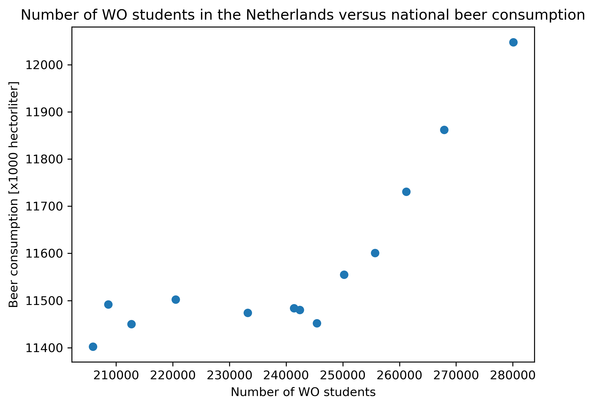

Student ID: 14627531

- The Rise of Coccidioides: Forces Against the Dust Devil Unleashed
- An analysis of the forces required to drag sheep over various surfaces
- The neurocognitive effects of alcohol on adolescents and college students 

The above figure is based on the data provided to us in the file `istherecorrelation.csv'.
The figure demonstrates the number of number of WO students versus beer consumption in the Netherlands.
There clearly is a correlation, an increase in the number of WO students corresponds to an increase in beer consumption.
Although these two quantities are correlated, it does not necessarily mean that there is a causal effect.
